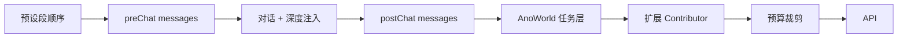

# 提示词流水线（目标规范）

本文描述 **每次调用文本 AI 之前** 如何把全局预设、玩家身份、故事素材与当次任务拼成模型输入。行为语义对齐 **SillyTavern / NativeTavern（酒馆）**；在 ST 拼装之上叠加 **AnoWorld 任务层**（合法出站、JSON schema、区间收敛等）。

实现对照同级仓库 NativeTavern：`chat_providers.dart` 的 `_buildContext`、`_buildSectionMessages`、`ChatGenerationPipeline.assemble`。

**状态**：正文为目标行为；文末 **「当前实现差距」** 记录仓库现状，随实现推进删除或改写该节。

---

## 1. 产出形态

- **目标**：OpenAI 式 **`messages[]`**（`role` + `content`），经各家 Chat API 发送。
  - Claude：多条 `system` 合并为单个 `system` 字段。
  - Gemini：合并进 `systemInstruction`。
- **Instruct 模板**：预设可保存；默认 **不拼接** 整段 instruct 字符串（`none`），由 API 处理多轮格式。仅本地/补全类通道再走模板 formatter。
- **采样**：`GenerationPreset`（温度、上下文长度、max tokens 等）与 messages **独立**；发送前按上下文预算裁剪（见 §6）。

AnoWorld **不要求** 无限开放世界聊；`chatHistory` 锚点内是 **游玩区间会话** 或 **创作侧固定轮次**，不是 ST 式无界聊天。

---

## 2. 输入来源（分层）

| 层 | 存放位置 | 作用 |
| --- | --- | --- |
| **AiPreset** | 设置 · 全局 | `prompts` + `prompt_order`、采样参数；与 ST JSON 兼容 |
| **Persona** | 设置 · 全局 | `{{user}}`、persona 段；可选覆盖 system / post-history |
| **故事包** | Project | WorldBook、Cast（主角 + 配角）、Main 节点摘要（可选注入） |
| **当次运行时** | 存档 / 会话 | 区间对话、作者注释、深度提示、摘要 |
| **当次任务** | 各 Action | 游玩聊天、回复选项、Main 区间、分步创作等 **taskSuffix** |

**分工**（与 [Core.md](./Core.md) 一致）：

| ST 段类型 | AnoWorld 来源 |
| --- | --- |
| `persona` | 当前 Persona |
| `charDescription` 等 | **焦点角色** = Cast 中勾选主角的一名；字段映射角色卡语义 |
| `worldInfo*` | WorldBook 条目（关键词命中 + 位置；见 §4） |
| `chatHistory` | 游玩区间 `TavernChatMessage` 列表或 VN/Main 区间 transcript |
| `main` / `jailbreak` / `custom` | 预设内文案 |
| **任务层**（非 ST） | 各 Action 追加；**不可被预设关掉** |

宏：`{{char}}`、`{{user}}`、描述类、时间/随机及 ST Macros 2.0 语法，在 **段文案写入 message 之前** 展开（对照 NT `MacroService`）。`{{char}}` 仅绑定主角 `CastMember`。

---

## 3. 流水线总览

```text
[读取] 启用中的 PromptSection（按 order）
    → 以 chatHistory 为锚点拆成 pre | 对话区 | post
    → 按类型生成 system/user/assistant 消息（宏已展开）
    → 对话区：摘要 / RAG / 逐条历史 + 深度注入
    → Context 扩展（记忆、状态块等，有 token 预算）
    → 回复长度等软约束（可选 system）
    → 上下文窗口 fit
    → assistant 预填（若配置）
    → HTTP 请求
```



**生成模式**（对齐 NT `ChatGenerationMode` 概念，AnoWorld 可子集实现）：

| 模式 | 上下文差异 |
| --- | --- |
| 发送 | 含完整历史；末尾预填可选 |
| 重生成 | 不含上一条 assistant |
| 续写 | 保留上一条 assistant，可接 prefill |
| 代玩家说 | 追加「仅从用户视角写」system；不用 assistant prefill |
| 带到某条之前 | `_buildContextUpTo(index)`，用于修复/分支 |

---

## 4. 提示词管理器：顺序与锚点

- 配置：`PromptManagerConfig`，段类型见 `lib/foundation/ai/st_prompt_manager.dart`（与 NT 枚举一致）。
- **仅 `enabled == true` 的段** 参与拼装；顺序 = `order` 升序。
- **`chatHistory` 是锚点**，不生成单条消息，只标记「此处插入对话」：
  - **preChat**：锚点之前所有段（含相对位置的 worldInfo、persona 等）。
  - **postChat**：锚点之后（典型：`postHistoryInstructions` / jailbreak、NSFW、worldInfoAfter、自定义）。

**默认顺序**（与 NT / ST 默认预设一致，可调）：

1. systemPrompt（Main）
2. persona
3. characterDescription → personality → scenario
4. exampleMessages
5. worldInfo（outlet 等）
6. authorNote（占位；真实内容按深度插入，§5）
7. **chatHistory**
8. worldInfoAfter
9. postHistoryInstructions

**深度注入段**：`injectionPosition == 1` 且 `injectionDepth != null` 的 custom 等，在 **遍历历史时** 按 depth 插入，不占 pre/post 列表位置。

**自定义段**：`PromptSectionType.custom`，`role` 可非 system（与 ST 导入一致）。

---

## 5. 各段如何变成 message

默认 **role = system**（段上 `role` 可覆盖）。内容经宏展开后写入 `content`。

| 段类型 | 内容来源（优先级从高到低） |
| --- | --- |
| systemPrompt | Persona 覆盖 system → 段内容 → 角色卡 system 字段 → 内置默认 RP 文案 |
| persona | Persona 描述；位置：beforeChar / inSystem / afterChar / atDepth（NT 同款） |
| character* | 主角 Cast 字段，带 `Description:` 等前缀 |
| exampleMessages | 主角例句 |
| worldInfo | 命中条目的 **位置** 决定插入点（before/after 角色、EM 上下、AN 上下、atDepth、outlet） |
| postHistoryInstructions | Persona PHI → 段内容 → 角色卡 PHI → 默认 |
| nsfw / custom | 段 `effectiveContent` |
| chatHistory | 见下节 |
| enhanceDefinitions | 预设文案（可默认关） |

**世界书**：按当前对话文本做关键词匹配；命中条目带 `[注释]\n正文` 包装。深度从 **最新消息算起 0**（与 ST 一致）。

**作者注释 / 角色 depth_prompt**：在对应 depth 的 **历史消息之前** 插入 `[Author's Note]` 或配置 role 的消息。

---

## 6. 对话区（chatHistory 锚点内）

按时间顺序回放区间消息，每条映射为 `user` / `assistant`（严格交替由产品层保证，见酒馆式游玩）。

在插入每条历史 **之前**，按 depth 可插入：

- 人设（atDepth / 与 AN 联动位置）
- 世界书 atDepth
- 深度注入的预设段
- 作者注释

**区段前/后附加**（在整段历史循环外）：

- **长对话摘要**：若有 summary，旧消息用一条 **assistant**（或约定 role）摘要替代，只保留 summary 之后的近期消息。
- **RAG / 检索**（若启用）：在最后一条用户消息相关处加 **system**。
- **生图结果**：不进文本模型上下文（与 NT 一致）。

记录 **`conversationStartIndex`**：第一条「纯对话」在最终 `messages` 中的下标，供 Contributor 在对话前插入扩展上下文。

**多模态**：用户消息可含附件时，`content` 为 parts 数组（与 NT 一致）；MVP 可仅文本。

---

## 7. AnoWorld 任务层（在 ST 拼装之后）

任务层 **不写入预设 JSON**，由各 Domain Action 注入，保证主脉络与输出形态：

| 场景 | 典型注入 |
| --- | --- |
| 酒馆式游玩聊天 | 文风、禁止替玩家说话、多角色在一轮内等（见 `TavernChatGenerateAction`） |
| 回复选项 | 选项数量与解析格式 |
| Main 区间 / Bridge | 当前站 synopsis、合法出边、`choices` JSON schema |
| 创作分步 | 仅输出 JSON / 字段说明 |

**原则**：

- 任务层可合并为一条或多条 **system**；不得让用户用预设关掉 **收敛规则**（合法下一站、end 等）。
- 与 `main` / jailbreak **并存**：预设管文风与人设边界，任务管 **这次调用要干什么**。

---

## 8. 拼装后处理

| 步骤 | 说明 |
| --- | --- |
| **Context Contributor** | 按注册顺序注入（长期记忆、Data Bank、状态块等）；placement：`beforeBase` / `beforeConversation` / `afterBase`；各有 token 上限 |
| **回复长度** | 可选末尾 system 软提示（impersonate 模式可跳过） |
| **上下文 fit** | `contextLength - maxTokens` 为输入预算；优先丢旧对话，必要时截断长 system |
| **assistant prefill** | 聊天「开头续写」配置 → 请求前追加半条 `assistant` |
| **工具调用** | 若启用 tool loop，在同一 message 链上追加轮次（后续能力） |

---

## 8b. 创作 Tool 任务层（P0）

| 动作 | taskSuffix 来源 | 说明 |
| --- | --- | --- |
| 角色卡 AI 分类整理 | [`CreatePromptProfiles.organizeCardTaskSuffix`](../lib/domain/ai/create/create_prompt_profiles.dart) | 只输出 JSON `operations`，禁止 paraphrase；仍走全局预设段顺序 |
| 清理格式 | 无 LLM | [`RichTextSanitizer`](../lib/foundation/text/rich_text_sanitizer.dart) 规则管线 |

编排经 [`CreateToolRegistry`](../lib/domain/ai/create/create_tool_registry.dart) / [`CreateAgentRunner`](../lib/domain/ai/create/create_agent_runner.dart)；P1 创作助手浮窗见 [CreateAgent.md](./CreateAgent.md)。

## 9. 与创作 / 双模式的衔接

- **全局一套预设** 服务：游玩聊天、VN 区间生成、创作器 AI 动作（用户字段可合成进 `user` 或单独 system，但 **预设段顺序一致**）。
- **VN / Main**：`chatHistory` 锚点内可以是 **压缩 transcript** 或结构化区间记录，而非 UI 上每一句气泡；摘要策略与 MainBeat 区间边界对齐（见 [MainBeat.md](./MainBeat.md)）。
- **配角**：完整 Cast 可通过 **自定义段** 或扩展 Contributor 注入；`{{char}}` 仍只指向主角。

---

## 10. 代码落点（目标）

| 职责 | 建议位置 |
| --- | --- |
| 段类型与 ST 导入 | `lib/foundation/ai/st_prompt_manager.dart`（已有） |
| 宏展开 | `lib/foundation/ai/macro_service.dart` |
| **多 message 拼装** | `lib/domain/ai/prompt_context_builder.dart`（新建，替代「整段 system 合并」） |
| 预设 + Persona 快照 | `lib/domain/ai/ai_prompt_context.dart` |
| 世界书匹配与位置 | `lib/domain/ai/world_info_matcher.dart`（新建） |
| 预算裁剪 | `lib/domain/ai/context_window_service.dart`（新建，可 port NT） |
| 各场景任务层 | 各 `*Action`（chat / main / create） |
| HTTP | `lib/foundation/ai/openai_chat_client.dart` 接收 `List<OpenAiChatMessage>` |

---

## 11. 当前实现差距（截至文档初稿）

| 项目 | 现状 | 目标 |
| --- | --- | --- |
| 预设段 | `PromptAssembler` 把除 `chatHistory` 外所有段 **拼成一条 system 字符串** | 按 §4–§5 输出 **多条 message**，尊重 `role` 与 worldInfo 位置 |
| 对话历史 | 塞进单个 **user** 消息里的「对话记录」文本块 | 锚点内 **逐条 user/assistant** |
| 深度注入 / AN / 摘要 | 未实现 | §5–§6 |
| 世界书 | `combinedText` 粗合并进 before/after | 关键词 + 位置矩阵 |
| Contributor / fit / prefill | 未实现 | §8 |
| 任务层 | 已有 `taskSuffix` 拼在 system 末尾 | 保留；改为可插入消息链固定位置（建议 postChat 之后） |

参考实现路径：`g:\Public\NativeTavern\lib\presentation\providers\chat_providers.dart`（`_buildContext`、`_buildSectionMessages`）。

---

## 12. 讨论时可对齐的检查项

1. VN 区间 transcript 是否一律走 `chatHistory` 多轮，还是允许「单 user 块」降级模式？
2. Main 节点 `synopsis` 进 preChat 的哪一段（custom vs 固定任务层）？
3. Contributor 第一版要做哪些（记忆、状态、RPG）还是先只做 fit？
4. 创作器 AI（纯 JSON）是否跳过 persona/例句等段，还是同一预设全启用？
5. 与 ST 预设导入：**禁用的段** 与 AnoWorld 任务层冲突时谁优先？（当前原则：任务层不可关）

---

## 相关文档

- [Core.md](./Core.md) — 预设、Persona、宏与故事包分工  
- [UX.md](./UX.md) — 设置里预设与提示词管理 UI  
- [MainBeat.md](./MainBeat.md) — 区间上下文与收敛  
- [prompts/PRD.md](../prompts/PRD.md) — 产品范围与非目标  